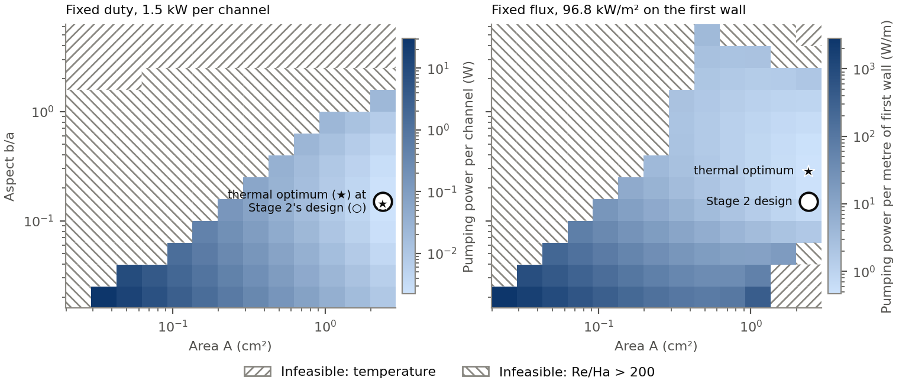
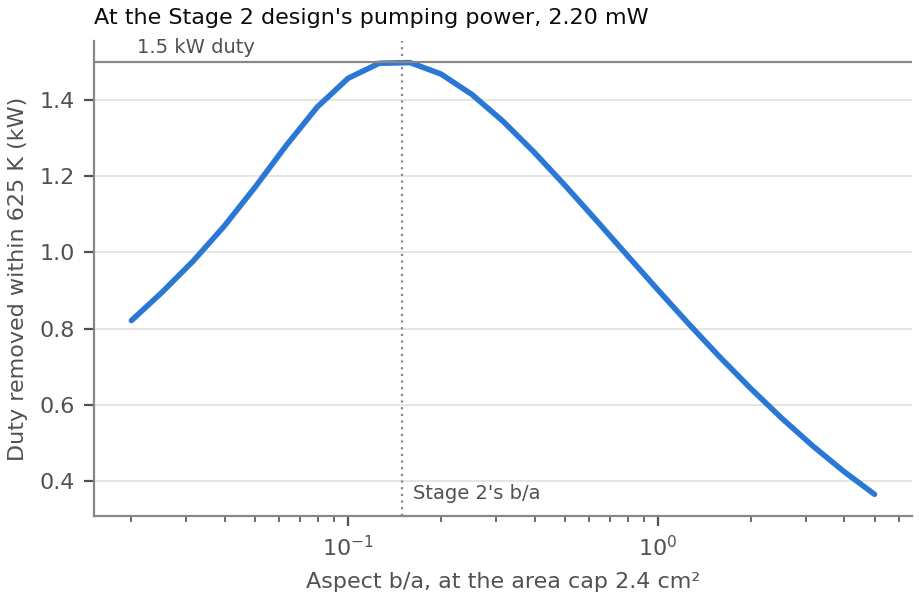

# Stage 3: a thermal design for Case P (LMhdX plan step 5.5)

**Status: run 2026-10-19, results below.** The specification, method and gates were committed before
the run (11ea591). They are unchanged here apart from this line. Where the run departed from them, the
[corrections and deviations](#corrections-and-deviations) say how and why. No gate was relaxed.

Stage 2 took each duct's area from a smallest allowed mean velocity, `V_min = 10 mm/s`, which stood
in for heat removal. Stage 3 asks the question directly. Which cross-section of the Case P channel
removes a first-wall heat load within a temperature limit, at the least pumping power? And what does
the velocity bound get wrong?

## The question, and why the flow must be free

At Stage 2's flow rate, `Q = 2.4e-6 m³/s`, the PbLi carries `ρ c_p Q = 4.48 W/K`. The temperature
allowance below, 52 K, then removes at most 233 W per channel, and the wall-to-bulk difference
across a 6 mm gap is only a few kelvin. A temperature limit at fixed `Q` would be almost pure energy
balance. At a fixed duty it would bound nothing, since the bulk rise does not depend on the shape.

So here **heat sets the flow**. For each shape, the flow rate is the smallest that keeps every
temperature within the limit, and the shape is chosen to make that flow cheapest to pump.

## Specification

The specification is illustrative. None of these values is an engineering requirement.

- **The channel** is Case P of Stage 2: the vertical poloidal duct at the outboard midplane,
  1.0 m long, in its uniform centre field `B_c = 0.4805 T`. The cross-duct `1/R` is neglected, as in
  Stage 2, where `case_p_correction` measured it. The walls are insulating, and the flow is fully
  developed and inertialess: Stage 2's evaluator.
- **The heat** enters through the wall `z = -b`, the one of width `2a` that faces the plasma, with
  `a` the half-width along the field. It is either:
  - **a fixed duty** of 1.5 kW per channel, whose flux `P/(2aL)` falls as the wall widens; or
  - **a fixed flux** of 96.82 kW/m², the equal-area square duct's flux at that duty, whose duty
    grows with `2a`.
- **The fluid** is Pb-17Li at 573 K, with Stage 2's properties (Martelli et al. 2019, Table 1)
  and `k = 20.4 W/(m K)` from the same table, so `Pr = 0.020`.
- **The inlet** is at 573 K.
- **The limits:**
  - the peak fluid and wall-interface temperatures at most 625 K, the top of the viscosity
    correlation's range;
  - `Re/Ha ≤ 200`, with `Re` on the hydraulic diameter and `Ha` on `a`, for laminar Hartmann
    layers;
  - an area of at most 2.4e-4 m². That is Stage 2's `V_min`-bound area, kept now as a geometric
    limit;
  - an aspect `b/a` in [0.02, 5], Stage 2's bounds.
- **The cost** is the hydraulic power `W = Q Δp`, with no pump efficiency.
- **Left out:** buoyancy (the flow is held), and Joule and viscous heating. Their sizes are measured
  on the candidate and reported.

## Method

The thermally fully developed duct of LMhdX (`lmhdx.thermal.developed_heat`, plan step 5.2) has
`ρ c_p u γ = k ∇²θ`, with `u ∝ Q` and the axial gradient `γ ∝ 1/Q`. The wall-to-bulk field `θ`
therefore depends on the shape alone, not on the flow rate. At the outlet:

```
T_peak = T_in + P / (ρ c_p Q) + (q'' a / k) Θ(β, Ha)
```

Here `Θ` is the dimensionless peak, of the wall and of the fluid, from one developed solve per
shape, on Stage 2's mesh family (one mesh per aspect, the field magnitude traced). Each shape's
cheapest feasible flow is then

```
Q_min = P / (ρ c_p (T_max - T_in - (q'' a / k) Θ_max))
```

and its cost is `W = Q_min² L μ / (a⁴ q(Ha, β))`. Stage 2's block-coordinate optimizer minimizes it
over `(u, w) = (ln A, ln β)`, with `dW/du` exact through `Θ`'s dependence on `Ha`. A shape whose
`Q_min` breaks `Re/Ha ≤ 200`, or for which the temperature allowance goes negative, is infeasible.

Each framing is also compared with Stage 2's design. That design is `A = 2.4e-4 m²` and
`b/a = 0.150`, at the same limits:
- **At fixed duty or flux:** its pumping power at its own `Q_min`, against the thermal optimum's.
- **At fixed pumping power:** the largest duty each sampled shape removes, at the Stage 2 design's
  power.

The plan row asks for both kinds of comparison.

## Gates

- **G1, scaling.** The dimensionless `Θ`, scaled, matches a dimensional `developed_heat` of the same
  physical design to 1e-10 relative.
- **G2, the reduction.** `θ` at two flow rates differs by at most 1e-12 relative, so `Q_min` is
  exact.
- **G3, the optimum.**
  - `dW/du` passes a Taylor test, including the path through `Θ(Ha)`.
  - At convergence, `dW/dw` is within Stage 2's stationarity tolerance.
  - An active bound carries a multiplier of the right sign.
- **G4, the mesh.** On the next mesh of Stage 2's family, 72/9 cells against the optimizer's 48/6,
  the candidate's `W` is within 1 % and its `β` within 2 %.
- **G5, an open duct.** The candidate's held flow, carried down an open duct from a 573 K inlet with
  upwind transport (`lmhdx.thermal.load_attribution`), must deliver at least 95 % of the duty at
  the outlet. Its peak must also stay within 625 K. The developed screening delivers every watt by
  construction, so this is checked on the candidate, as on LMhdX's design page.
- **G6, the neglected terms.**
  - The candidate's `Re/Ha` is at most 200.
  - Joule and viscous heating, measured against the duty, are at most 1e-3.
  - The buoyancy ratio `Ri/N` is reported, not graded: the flow is held.

## Outputs

`results.json` will hold every input, value and gate; figures go in `figures/`. This README then
becomes the write-up. LMhdX's plan row 5.5 points here.

## Results

**Run:** 2026-10-19 · duct-opt 3910a07 · LMhdX 47319aa (main, with the thermal module; the package
source was clean) · Python 3.10.21 · JAX 0.6.2 · NumPy 2.2.6 · SOLVAX 0.19.0 · CPU, WSL2.
- **Process:** each stage ran as its own process, with its output in [logs/](logs).
- **Record:** [results.json](results.json) holds every input, value and gate.

| | Fixed duty, 1.5 kW per channel | Fixed flux, 96.82 kW/m² |
|:--|--:|--:|
| Cost | pumping power per channel | pumping power per metre of first wall |
| Thermal optimum: area, b/a | 2.40 cm² (the cap), 0.144 | 2.40 cm² (the cap), 0.284 |
| Half-widths a × b | 20.4 × 2.9 mm | 14.5 × 4.1 mm |
| Its cost | 2.194 mW | 0.460 W/m (13.4 mW per channel) |
| Duty per channel | 1500 W | 2815 W |
| Cheapest flow `Q_min` | 1.73e-5 m³/s, 7.2 cm/s | 4.08e-5 m³/s, 17.0 cm/s |
| Bulk rise and film, of 52 K | 46.4 K and 5.6 K | 36.9 K and 15.1 K |
| `Re/Ha`, `Ha` | 17, 199 | 71, 142 |
| Stage 2's design (2.40 cm², b/a 0.150) | 2.196 mW, ×1.001 | 0.559 W/m, ×1.21 |

**At a fixed duty, Stage 2's design is the thermal optimum, to 0.1 %.**
- **Why:** both sit on the area cap. Near the optimum the shape barely moves the temperature: the
  film is 5.6 K of the 52 K allowance. So the cheapest shape is the one Stage 2 chose for pumping
  power alone.
- **What the velocity bound gets wrong is the flow, not the shape.** Removing 1.5 kW within 625 K
  takes 7.2 cm/s, 7.2 times Stage 2's `V_min` of 10 mm/s.

**At a fixed first-wall flux, the optimum is squarer: b/a 0.28 against Stage 2's 0.15.**
- **Why:** a flatter duct is wider along the field, so its wall collects more of the plasma's
  flux. Stage 2's design carries 3.88 kW per channel against the optimum's 2.82 kW, and needs 35 %
  more flow for it.
- **The cost:** Stage 2's design costs 21 % more per metre of first wall.

**At a fixed pumping power** (Stage 2's design's, 2.196 mW, at the area cap), the duty a shape
removes within 625 K peaks near b/a 0.16, at 1.50 kW (figure F2). A square duct removes 0.90 kW,
and b/a 5 removes 0.37 kW. Every sampled shape stays laminar.



*F1. The cost of each shape's cheapest feasible flow, over the area and the aspect, on the 13 × 13
landscape (48/6 cells). Hatched shapes are infeasible: either no flow keeps the peaks within 625 K,
or the flow that does breaks `Re/Ha ≤ 200`. The star is the thermal optimum and the ring Stage 2's
design. They coincide at a fixed duty.*



*F2. At the Stage 2 design's pumping power, the duty each aspect removes within 625 K at the area
cap.*

## Gates

| Gate | Fixed duty | Fixed flux | Verdict |
|:--|:--|:--|:--|
| G1, scaling | worst 4.4e-13 of the rise, over 5 designs, both framings | | pass (1e-10) |
| G2, flow independence | worst 1.7e-16 | | pass (1e-12) |
| G3, Taylor slope in u | 1.9993 | 1.9997 | pass ([1.9, 2.1]) |
| G3, stationarity, Richardson and h/10 | −3.4e-7, −4.6e-7 | **−1.8e-6, −1.9e-6** | duty pass, **flux fail** (1e-6) |
| G3, the active bound | area cap, multiplier +3.7e-3 | area cap, multiplier +0.33 | pass (≥ 0) |
| G4, 72/9 against 48/6 | W 0.24 %, b/a 0.37 % | W 0.36 %, b/a 0.30 % | pass (1 %, 2 %) |
| G5, open duct, delivered | 99.97 % of 1500 W | 99.98 % of 2815 W | pass (≥ 95 %) |
| G5, open duct, peak | 624.81 K | 624.53 K | pass (≤ 625 K) |
| G6, `Re/Ha` | 17 | 71 | pass (≤ 200) |
| G6, viscous and Joule heating over the duty | 9.9e-7, 4.7e-7 | 2.8e-6, 2.0e-6 | pass (≤ 1e-3) |

**G3 fails for the fixed flux.**
- **The reading:** the polished stationarity on Stage 2's scaled-mesh family reads −1.8e-6
  (Richardson) and −1.9e-6 (h/10), against Stage 2's 1e-6.
- **What it means:** with the landscape's curvature (`W''/W` ≈ 0.7 in ln b/a), a slope that size
  moves the optimal b/a by about 3e-6 of itself. That is far inside G4's 0.3 % mesh change and
  the 1 % the polish and the optimizer differ by (b/a 0.2812 and 0.2839).
- **The record stands as a fail.** A post-hoc diagnostic, made after the run and not part of the
  gate, repeated the polish centred at its own minimum
  ([posthoc_polish_flux.json](posthoc_polish_flux.json)). The minimum stays at 0.28116, and the
  reading stays −2.2e-6. So the residual is not the fit's centring; it is a small, consistent bias
  of the quartic over its ±0.1 window.

The reported but ungraded values:
- **Buoyancy:** `Ri/N` is 0.029 and 0.023. The buoyancy-driven velocity is a few percent of the
  forced one, so the held flow is a fair first model.
- **Dissipation:** viscous plus Joule equals the pumping power to 1e-11, a check of `W` through
  LMhdX's energy budget.
- **The step study:** Stage 2's finite-difference `dW/dw` across rebuilt meshes spreads by 55 % and
  26 % over its plateau. That spread is the mesh-to-mesh noise that sent G3 to the scaled-mesh
  family, as in Stage 2.

## Corrections and deviations

1. **The fixed-flux cost was corrected after the first run.**
   - **The problem:** the set-up costed both framings by pumping power per channel. Under a fixed
     first-wall flux a channel's duty grows with its wall width `2a`, so that cost rewards a narrow
     channel for taking less heat, which only moves the heat to more channels.
   - **What the first run showed:**
     - its fixed-flux "optimum" was b/a 2.72 at 0.47 cm², which costs 2.40 W per metre of first
       wall;
     - Stage 2's design costs 0.56 W/m.
   - **The fix:** the fixed flux is now costed per metre of first wall, `W / (2a)` (3910a07), and
     every stage was rerun.
   - **The record:** the first run's fixed-flux records stay in
     [superseded_per_channel_flux.json](superseded_per_channel_flux.json). The fixed duty's cost
     is per channel, so the correction did not change it, and its numbers are identical in both
     runs.
2. **The optimizer nests Stage 2's two steps rather than alternating them.** Each aspect sample
   takes its exact best area, by Stage 2's bisection on `dW/du`. Stage 2's quadratic bracket then
   works on that profile in the aspect. Alternated, as the set-up describes, the steps zig-zagged
   along the coupled valley of a trial run: four rounds moved b/a by about 3 % each.
3. **How G3's stationarity was measured.** It was read as Stage 2 read it, on the scaled-mesh
   family, with Stage 2's `c_stationarity_rel` of 1e-6 applied to the Richardson and h/10
   readings. The h and 2h readings carry the h² truncation and are reported only, as in Stage 2's
   record. This was fixed in the code (348aafd) before the first run.
4. **`Re/Ha` takes `Re` on the hydraulic diameter,** as the set-up says, where Stage 2 took it on
   `a`. For these shapes `D_h/a` is 0.5 to 0.9, so the two differ by that factor.

## Limits

- **The specification is illustrative.** The 1.5 kW duty, the 625 K limit, the 2.4 cm² cap and the
  0.48 T field are not a blanket's numbers. The 2.4 cm² cap is binding in both framings, so the
  optimum area is the cap's, not a property of the physics.
- **The physics is a forced-convection screening:**
  - constant properties;
  - insulating walls and no conjugate wall;
  - a held, inertialess flow with no buoyancy;
  - one heated wall, with no volumetric heating;
  - Case P's uniform field, without the cross-duct `1/R`.
- **The open-duct check** is one 12-cell axial mesh. It confirms the delivered share and the peak,
  but it is not an entrance-length study.
- **Only Case P is designed here.** A first-wall flux does not heat Case R's radial ducts along
  their length; they need volumetric heating, which this study leaves out.
