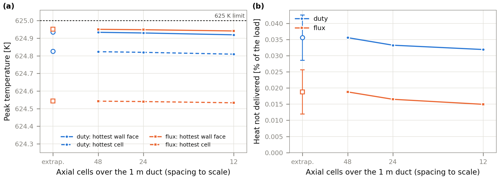
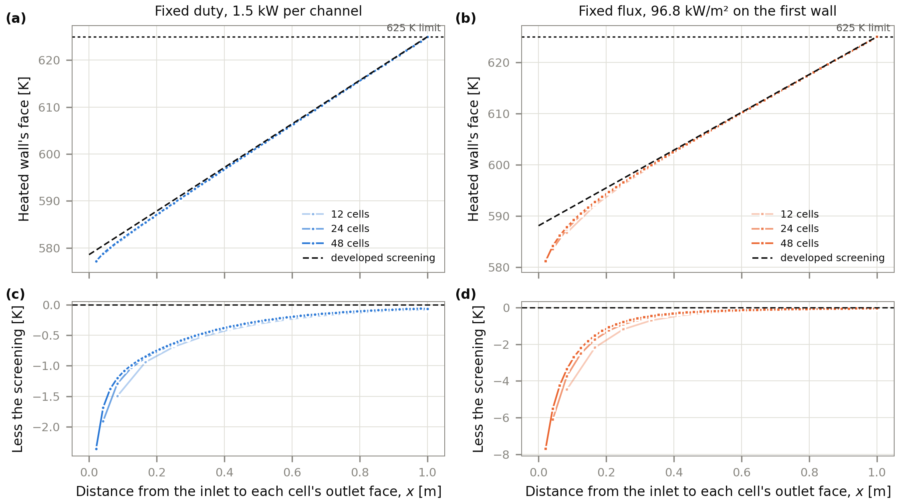
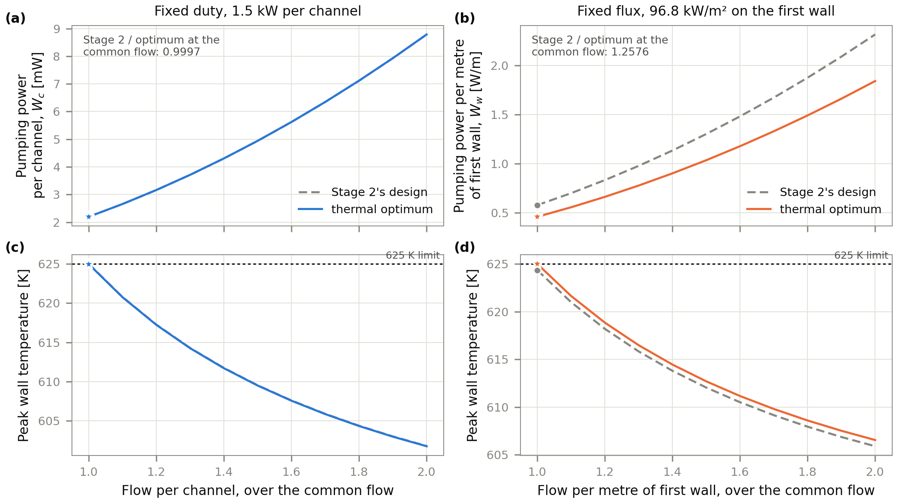

# Stage 3 v2: the open duct refined, the wall face, a common feasible flow

**Status: run 2026-10-19, results below.** The specification, method and gates were committed before
the run (5adcd8a). They are unchanged here apart from this line. Every gate and check passes, and none
was relaxed. The one change after the run is to how a figure is drawn; [the
deviations](#deviations) record it.

**Run:** 2026-10-19 · **LMhdX** 1.11.0 (`4e1b6b3`, `src` clean) · **Python** 3.10.21 · **JAX** 0.6.2 ·
**NumPy** 2.2.6 · **SOLVAX** 0.19.0 · CPU, WSL2 · about 2.5 minutes in all. As in v1, the editable
install's metadata still reads 1.10.0; the SHA is the code that ran.

Stage 3 ([results/stage3-thermal](../stage3-thermal/README.md), release `stage3-v1`) left three items
open. This study measures them. Its record stays separate, and v1's is read but never rewritten.

1. **The open duct on one axial mesh.** v1's G5 ran each optimum's held flow down an open duct on 12
   axial cells. That shows a discrete balance at one resolution, not a grid-independent delivered
   share or entrance temperature.
2. **The hottest cell, not the wall.** v1's G5 graded the hottest fluid cell. The developed screening's
   binding peak is the heated wall's face, and the open duct did not measure it.
3. **No comparison at a common flow.** v1 compared Stage 2's design with each optimum at each one's own
   cheapest feasible flow. A comparison at one flow that both shapes can carry keeps the bulk
   temperature rise equal and isolates what the shape changes: the wall-to-bulk film and the
   hydraulic power.

v1's fixed-flux stationarity gate (G3, −1.8e-6 against 1e-6) stays an open, recorded exception. This
study does not revisit it.

## Specification

Everything is v1's: Case P, Pb-17Li, the 573 K inlet, the 625 K limit, the two framings (1.5 kW per
channel, or 96.82 kW/m² on the first wall), and Stage 2's 48/6 cross-section mesh. The candidates are
read from v1's `results.json`:

- the fixed-duty optimum (b/a 0.1437);
- the fixed-flux optimum (b/a 0.2839);
- Stage 2's design (b/a 0.150, A = 2.4e-4 m²).

LMhdX is 1.11.0 (`4e1b6b3`), on which v1 reproduces bit for bit.

## Method

**A. The open duct, refined along its axis** (stages `refine_duty`, `refine_flux`)

Each optimum's held flow is carried down the 1 m duct from a uniform 573 K start, exactly as in v1's
G5:

- upwind transport;
- a Courant number of 0.5 along the duct;
- six residence times, by which the duct is steady;
- the delivered share from `lmhdx.thermal.load_attribution`.

The axial mesh is 12, 24 and 48 cells. The cross-section stays 48/6; G4 measured its own refinement.

At each level the run is made twice:

- **Wall flux as a source**, as in v1: `q'' A / V` in the row of fluid cells along the heated wall.
  `load_attribution` needs the load as a source.
- **Wall flux as a boundary condition**: the same flux, with no source. In the finite-volume balance
  a face flux enters its cell exactly as that source does, so the two must agree (C1).

From each final state the study takes:

- **the hottest cell**: v1's quantity, the largest cell temperature over the run;
- **the hottest wall face**: the largest face temperature on any transverse wall. A face's value is
  defined as in LMhdX's developed duct (`developed_heat`): the mean of the wall cell and its ghost
  under the wall's own condition, from `lmhdx.grid.pad`. On the heated wall that is
  `T_P + q'' h / (2k)`, with `h` the wall cell's width. On an insulated wall it is the cell value.
- **the outlet's mixed-cup temperature**: weighted by the axial flow. With the delivered share it
  checks the heat delivered at the outlet.
- **the heated wall's face temperature along the duct**: its largest value across the wall, in each
  axial cell. The figure for this is reported, not gated.

**Extrapolation.** Each quantity is extrapolated from its three levels (refinement ratio 2):

- **monotone convergence:** the observed order is `p = ln(e₃₂ / e₂₁) / ln 2`, with `e₂₁ = f₂₄ − f₄₈`
  and `e₃₂ = f₁₂ − f₂₄`. The Richardson value is `f₄₈ + (f₄₈ − f₂₄) / (2^p − 1)`, with Celik's (2008)
  band `1.25 |f₄₈ − f₂₄| / (2^p − 1)`;
- **otherwise** (the differences change sign or grow): no extrapolation. The value is `f₄₈` and the
  band is three times the larger difference (Roache's factor for an unconfirmed order).

**B. A common feasible flow** (stage `common_flow`)

Each framing compares its optimum with Stage 2's design at one common flow:

- **fixed duty:** the flow per channel;
- **fixed flux:** the flow per metre of first wall, `Q / (2a)`.

Either way, the two shapes then have the same bulk temperature rise. The common flow is the larger of
the two shapes' cheapest feasible flows, so both can carry it.

At that flow, and up to twice it, the study reports for each shape:

- the cost `W`, in v1's units: per channel for the duty, per metre of first wall for the flux;
- the pressure drop;
- the film, the wall-to-bulk difference;
- the peak wall temperature and its margin below 625 K;
- `Re/Ha`;
- for the flux, the load per channel and the channels per metre of first wall.

These follow from one developed solve per shape (v1's `Θ`, independent of the flow, G2), on 48/6
and on 72/9.

**The rule for a difference.** A difference between the shapes that is smaller than its own change
between 48/6 and 72/9 is reported as no difference.

## Gates and checks

| Name | What | Threshold |
|:--|:--|:--|
| C0, v1 reproduced | the 12-cell source run's delivered share and hottest cell against v1's G5 record | 1e-12 relative |
| C1, the two formulations | final temperature, wall flux as a source against wall flux as a boundary condition, at every level | 1e-9 of the temperature rise |
| G5a, delivered, refined | `f₄₈` and the extrapolated value minus its band | ≥ 95 % (v1's threshold) |
| G5b, the hottest wall face, refined | `f₄₈` and the extrapolated value plus its band | ≤ 625 K (the specification's limit) |
| C2, the common flow's closed form | a dimensional `developed_heat` of each shape at the common flow against the closed form, on 48/6 | 1e-10 of the rise (v1's G1) |

**Reported, not gated:**

- the hottest cell, refined;
- the observed orders;
- the outlet's mixed-cup temperature;
- the open duct's wall-face peak against the developed screening's 625 K (the entrance region's margin);
- the wall temperature along the duct;
- every quantity of B.

## Outputs

- `run.py`: the driver. `python results/stage3-v2/run.py <stage> | all | finalize`, one stage per
  process.
- `checkpoint.json` and `results.json`: strict JSON, with v1's SHA and LMhdX's recorded.
- `make_figures.py`: the figures, from `results.json` alone, in Stage 2's house style.
- `figures/`, `logs/`.

This README then becomes the write-up. LMhdX's plan row 5.5 and
[uwplasma/LMhdX#271](https://github.com/uwplasma/LMhdX/pull/271) point here.

## Results

### A. The open duct, refined

The 12-cell runs reproduce v1's G5 record bit for bit (C0: a relative difference of 0). The two
formulations of the wall flux agree to 5e-14 of the temperature rise at every level (C1).

| Fixed duty | 12 cells | 24 cells | 48 cells | Extrapolated |
|:--|--:|--:|--:|:--|
| Hottest wall face [K] | 624.919 | 624.930 | 624.934 | 624.936 ± 0.003 (order 1.49) |
| Hottest cell [K] | 624.809 | 624.820 | 624.824 | 624.826 ± 0.003 (order 1.49) |
| Delivered [% of 1500 W] | 99.968 | 99.967 | 99.964 | not monotone: 99.964 ± 0.007 |
| Outlet mixed cup [K] | 619.436 | 619.436 | 619.435 | not monotone: 619.435 ± 0.003 |

| Fixed flux | 12 cells | 24 cells | 48 cells | Extrapolated |
|:--|--:|--:|--:|:--|
| Hottest wall face [K] | 624.941 | 624.948 | 624.951 | 624.952 ± 0.001 (order 1.66) |
| Hottest cell [K] | 624.533 | 624.540 | 624.542 | 624.543 ± 0.001 (order 1.66) |
| Delivered [% of 2815 W] | 99.985 | 99.983 | 99.981 | not monotone: 99.981 ± 0.007 |
| Outlet mixed cup [K] | 609.919 | 609.919 | 609.918 | not monotone: 609.918 ± 0.003 |

*V1. (a) The hottest face of any wall (solid) and the hottest cell (dashed) on 12, 24 and 48 axial cells,
with the extrapolated value and its band (open markers). (b) The share of the load conducted back out of
the inlet rather than delivered at the outlet.*

**The hottest wall face is within the limit,** at 624.936 ± 0.003 K for the fixed duty and
624.952 ± 0.001 K for the fixed flux, so G5b passes. It sits 0.064 K and 0.048 K below 625 K, and it
rises toward the limit as the axial mesh is refined, at an observed order of about 1.5. The hottest
cell is the heated wall's cell at the outlet. The face is above it by exactly `q'' h / (2k)`, the
conduction across that cell's half-width: 0.110 K and 0.408 K. v1 graded the cell; the face is the
binding temperature.

**Delivery stays far above 95 %** (G5a): 99.964 % and 99.981 % on 48 cells. The rest, 0.036 % and
0.019 % of the load, is conducted back out through the inlet. It grows slightly as the inlet cell
narrows and resolves the gradient there, so the differences grow rather than shrink, and the
README's rule then gives no extrapolation. Even so, the band is 1/700 of the margin. The outlet's
mixed-cup temperature confirms the share: `ρ c_p Q (T_out − T_in)` matches the attributed delivery to
3e-11.

**The developed screening is conservative here.** V2 draws the heated wall's face along the duct
against the screening, which takes the profile as developed from the inlet. The open duct's wall
stays below it everywhere:

- by up to 2.4 K (fixed duty) and 7.7 K (fixed flux) in the first cell, where the thermal boundary
  layer is thin;
- by 0.06–0.07 K and 0.05 K over the last part of the duct.

So the screening's binding peak is approached from below at the outlet, and this entrance study
does not move it.

*V2. The heated wall's face temperature along the duct, its largest value across the wall in each axial
cell, on 12, 24 and 48 cells (light to dark), against the developed screening (dashed). Each cell is
drawn at its outlet face, where upwind transport places its value. Bottom: the difference, the entrance
region's margin.*

### B. A common feasible flow

| | Fixed duty, 48/6 | | Fixed flux, 48/6 | |
|:--|--:|--:|--:|--:|
| | **thermal optimum** | **Stage 2's design** | **thermal optimum** | **Stage 2's design** |
| b/a; half-width `a` [mm] | 0.144; 20.4 | 0.150; 20.0 | 0.284; 14.5 | 0.150; 20.0 |
| Common flow | 1.7306e-5 m³/s per channel | (same) | 1.4043e-3 m²/s per m of wall | (same) |
| Flow per channel [m³/s] | 1.7306e-5 | 1.7306e-5 | 4.083e-5 | 5.623e-5 |
| Cost | 2.1971 mW | 2.1964 mW | 0.4605 W/m | 0.5791 W/m |
| Stage 2 / optimum, 48/6 and 72/9 | | 0.99971, 0.99977 | | 1.2576, 1.2568 |
| Pressure drop [Pa] | 127.0 | 126.9 | 328 | 412 |
| Film, wall − bulk [K] | 5.549 | 5.581 | 15.075 | 14.424 |
| Peak wall [K]; margin [K] | 624.968; 0.032 | 625.000; 0 | 625.000; 0 | 624.348; 0.652 |
| `Re/Ha` | 17.0 | 17.6 | 70.7 | 57.3 |
| Load per channel; channels per m of wall | 1500 W; 24.5 | 1500 W; 25.0 | 2815 W; 34.4 | 3877 W; 25.0 |

The common flow is the larger of the two shapes' cheapest feasible flows. For the fixed duty that is
Stage 2's design's, 0.07 % above the optimum's own. For the fixed flux it is the optimum's, 1.8 %
above Stage 2's per metre of wall. The closed form matches a dimensional `developed_heat` at the
common flow to 2.0e-12 of the rise (C2).

**At a fixed duty the two shapes are the same design.**
- At one flow, Stage 2's slightly squarer shape is 0.03 % cheaper to pump. Its film is 0.03 K
  thicker, so it uses the whole allowance where the optimum keeps 0.03 K.
- That 0.03 K lets the optimum run 0.07 % less flow, which is why it wins by 0.1 % at its own
  cheapest flow (v1).
- Both differences exceed their change from 48/6 to 72/9 (6e-5 in the ratio, 0.002 K in the film).
  By the README's rule they are real, but they are too small for any design to notice.

**At a fixed flux the shape matters at equal flow too.** Per metre of first wall and at the same bulk
temperature rise:
- Stage 2's design costs 26 % more to pump: 1.2576 on 48/6 and 1.2568 on 72/9.
- Its wider, flatter channel has a film 0.65 K thinner, and it ends 0.65 K below the limit.
- The optimum spends that margin on its film and takes the saving in pressure drop: 328 against
  412 Pa, over 34 rather than 25 channels per metre.

At each shape's own cheapest flow v1 found 21 %. The ratio is larger here because the common flow
pushes Stage 2's design past its own minimum.

*V3. Each framing's thermal optimum and Stage 2's design from the common flow (markers) to twice it, on
48/6: the cost (top) and the peak wall temperature (bottom). At the fixed duty the curves overlap.*

## Gates and checks

| Name | Fixed duty | Fixed flux | Verdict |
|:--|:--|:--|:--|
| C0, v1 reproduced | 0 | 0 | pass (1e-12) |
| C1, the two formulations | 4.8e-14 | 3.3e-14 | pass (1e-9) |
| G5a, delivered, refined | 99.964 %; 99.957 % at the band's low end | 99.981 %; 99.974 % | pass (≥ 95 %) |
| G5b, hottest wall face, refined | 624.934 K; 624.938 K at the band's top | 624.951 K; 624.953 K | pass (≤ 625 K) |
| C2, the common flow's closed form | 1.7e-13 | 2.0e-12 | pass (1e-10) |

## What this closes in Stage 3

- **The open duct.** It is now refined, with the wall face measured. On 12, 24 and 48 axial cells
  the candidates deliver their heat and keep the heated wall's face within 625 K. The extrapolated
  margin is 0.06 K and 0.05 K, with bands of 0.003 K and 0.001 K. The screening's peak is approached
  from below.
- **The common flow.** The comparison is made. At a fixed duty the shape barely matters. At a fixed
  flux, Stage 2's design costs 26 % more per metre of first wall at equal flow, and 21 % more at each
  shape's own cheapest flow.
- **Still open:** v1's fixed-flux stationarity, G3 at −1.8e-6 against 1e-6. It is untouched here
  and remains a recorded exception.

## Deviations

1. **V2 draws each cell at its outlet face, not its centre.** This was decided after the first draw
   and changes no number. With upwind transport a cell carries the temperature of its outlet face,
   exactly so for a linear rise. Drawn at its centre, each coarse curve sat `γ h / 2` above the
   screening: 1.9, 1.0 and 0.5 K for the duty. That reads as an open duct hotter than the screening,
   which it is not. The gated peaks are cell and face maxima, so no gate depends on this choice.

## Limits

- **The open duct's cross-section is 48/6 throughout.** G4 measured that mesh's effect on the
  design. The axial refinement here is at fixed cross-section, with upwind transport and a held flow.
- **The wall face is the fluid side of the interface.** There is no conjugate wall, so the solid's own
  peak is not modelled.
- **The common-flow comparison is at the screening level,** from the developed duct, not from the
  open duct.
- **Everything else is v1's:** the illustrative specification, the forced-convection physics
  (constant properties, insulating walls, no buoyancy), and Case P only.
